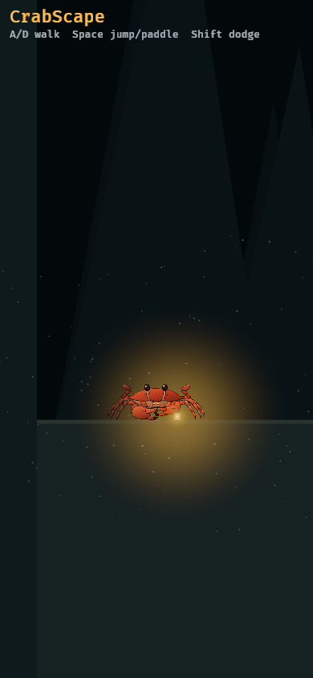

# CrabScape 🦀

A side-scrolling game where you are a heavy, lantern-carrying crab on the
deep-sea floor. It's written in [Rust](https://www.rust-lang.org/) with the
[Bevy](https://bevy.org/) game engine, and it runs in a web browser (phones
too) as WebAssembly, or as a normal desktop program.

Right now it's **milestone 1**: one small test level, one crab,
single-player. The crab is a cut-out puppet built from the art in
`art/crab/`, and it carries the only light in the sea: a jar of glowing
bacteria in its cutter claw. Walk, jump (strong push off the floor, heavy
fall slowed by the water), paddle-stroke for a double jump, and dodge with a
quick sideways scuttle. Reload the page and the crab is still where you left
it.

| Action | Keyboard | Controller | Phone |
|---|---|---|---|
| Walk | A / D or the arrow keys | left stick or d-pad | `<` `>` buttons |
| Jump | Space (or W, Up, K); hold for higher | A | JUMP |
| Paddle stroke (double jump) | jump again in the water | A again | JUMP again |
| Dodge (on the floor) | Shift (or J) | B, X or a trigger | DODGE |
| Art style (oil paint / ink) | P | | "Style" button, top right |

The crab comes in two looks: **oil-painted** (the default) and the original
**ink** drawing. The choice is remembered by the browser.



Milestone 0 (top-down, click to walk) is in the git history.

**Play the latest build:** <https://stevenkauwe.github.io/crabscape/> (deployed from `main` once the repository is
public; every CI run also keeps the built `web/` folder as a downloadable artifact).
**Want to help?** See [CONTRIBUTING.md](CONTRIBUTING.md). Claude sessions start from [CLAUDE.md](CLAUDE.md) and the
one-page design notes in [docs/design/](docs/design/).

## Run it on your computer

You need Rust. If you don't have it, install it from <https://rustup.rs>.

```sh
cargo run
```

The first build takes a few minutes, because Bevy is big. After that it's quick.
On the desktop the crab's position is saved in `crabscape-save.json` in the
folder you ran it from.

Checks to run before you share a change:

```sh
cargo fmt                                  # tidy the code layout
cargo clippy --workspace --all-targets -- -D warnings  # catch common mistakes (game + art tools)
cargo test --workspace                     # run the tests (jump heights, the level, the save format, the crab rig, ...)
```

## Build it for the web

One-time setup:

```sh
rustup target add wasm32-unknown-unknown
cargo install wasm-bindgen-cli --version 0.2.129   # must match wasm-bindgen in Cargo.lock
cargo install wasm-tools                           # optional: checks the .wasm will load on iPhones
```

[`wasm-opt`](https://github.com/WebAssembly/binaryen) is also optional; it
shrinks the file by about 15%. The build script uses it if it can find it.

Then build:

```sh
tools/build-web.sh
```

This fills `web/` with everything the game needs: `index.html`, the
JavaScript glue in `web/pkg/`, the game itself (`web/pkg/crabscape_bg.wasm`),
and the crab's pictures in `web/assets/crab/`, which the game fetches when it
starts (keeping them out of the `.wasm` keeps it under 15 MiB). It also writes `web/artifact.html`, the same page without the
`<html>`/`<head>`/`<body>` tags, for hosts that add their own.

### Play it locally

Browsers won't load WebAssembly straight from a file, so serve the folder:

```sh
python3 -m http.server -d web 8000
```

and open <http://localhost:8000>. To try it on your phone, connect it to the
same Wi-Fi and open `http://YOUR-COMPUTER'S-IP:8000`.

`web/` uses only relative links, so you can upload it anywhere: a subfolder
on GitHub Pages, or inside an iframe.

### Test it in WebKit (the iPhone's engine)

```sh
python3 tools/test-webkit.py --shots docs/side-on
python3 tools/test-webkit.py --landscape
```

This opens the game in WebKitGTK at an iPhone's screen size with an iPhone's
user agent. It presses keys and the on-screen touch buttons, checks that the
crab walks, jumps and paddles, that its position is saved and survives a
reload, and saves screenshots. It needs WebKitGTK 4.1 and its Python
bindings (on Arch: `webkit2gtk-4.1` and `python-gobject`).

## How the code is laid out

| File | What it does |
|---|---|
| `src/main.rs` | Starts the app. Read this first: it explains the Bevy basics (App, plugins, entities, components, resources, systems, messages). |
| `src/tuning.rs` | **Every number that decides how the crab feels** (speeds, jump, sinking, drag, dodge, camera lag, light radius), with comments. Start here to experiment. |
| `src/level.rs` | The test level: the sea-floor line and the rock boxes, and drawing them. |
| `src/physics.rs` | Walking, sinking, jumping (coyote time, jump buffering), paddling, dodging, collisions. Plain Rust with unit tests. |
| `src/player.rs` | The crabs: spawning them, and running their physics 120 times a second. |
| `src/input.rs` | Turns keys, controllers and the on-screen touch buttons into move requests. |
| `src/puppet.rs` | The crab as a cut-out puppet: pieces pinned at their joints, animated in code (walk, bob, eyestalks, paddles, claws, squash). |
| `src/lantern.rs` | The lantern and its cheap fake light: things near it get their colour back, things far away go dark. |
| `src/effects.rs` | Bubbles, sand puffs and marine snow. |
| `src/save.rs` | Saves the crab's position in the browser's `localStorage`, or in a file on the desktop. |
| `src/view.rs` | The camera, which follows the crab with a little lag, and the HUD text. |
| `src/style.rs` | The art style (oil paint or ink), the P key and the "Style" button that switch it. |
| `assets/crab/` | The crab's pieces in one picture (`crab-atlas.png`, and `crab-atlas-oil.png` painted), plus their joints (`crab-parts.json`, baked into the game). The pictures are loaded when the game starts. |
| `crates/crabrig/` | The crab as a parametric puppet (proportions, poses, named parts with joints). `crabrig parts` writes `art/crab/crab-parts.svg`; `crabrig export` writes `assets/crab/` from it. |
| `crates/painter/` | The owner's oil painter and pure-Rust p5.brush port (`crabpaint`), moved in from music-to-movie-magic. |
| `tools/paint-oil-crab.sh`, `tools/oil-atlas/` | Oil-paints the parts into `crab-atlas-oil.png`, keeping each part's outline. |
| `tools/build-web.sh` | Builds the web version into `web/`. |
| `tools/test-webkit.py` | Plays the web build in a real WebKit engine. |

An important design choice, made with multiplayer in mind: **nothing moves
the crab directly.** Every frame, input sends a `MoveRequest` message
("player 0 wants to walk right with jump held"), and the physics acts on
those requests. When networking arrives, requests from other players will
go through the same path. The physics also runs in fixed steps of 1/120 s,
so every computer simulates the same motion.

## Changing the crab's art

The crab is a parametric puppet in `crates/crabrig/` (its proportions,
poses and parts). It writes `art/crab/crab-parts.svg`, where every piece is a
named group with the piece it hangs from and the joint it turns around, and
the game's pictures come from that file. Everything is `cargo run`, nothing
else to install. After changing the crab:

```sh
cargo run -p crabrig --profile art -- parts    # art/crab/crab-parts.svg
cargo run -p crabrig --profile art -- export   # assets/crab/crab-atlas.png + crab-parts.json
tools/paint-oil-crab.sh                        # the oil-painted copy (about 15 s)
cargo run
```

`cargo test --workspace` fails if the SVG or the parts file is out of date
with the puppet.

Pieces the animation moves are found by name (`leg-L1-merus`,
`cheliped-R-dactyl`, `eye-L-stalk`, ...). If a name disappears, the game
still runs; that piece just stops moving.

## Why some settings are the way they are

- **Bevy runs with most features switched off** (see `Cargo.toml`). That
  keeps the download smaller. Turn a feature back on when you need it (sound,
  for example, is `"bevy_audio"` plus a format such as `"vorbis"`).
- **WebGL2, not WebGPU**, so it runs on every iPhone and older browsers.
- **No relaxed SIMD.** iPhones (WebKit) refuse to load a WebAssembly file that
  contains even one relaxed-SIMD instruction. The build adds no special CPU
  features, and `build-web.sh` checks the file with `wasm-tools`.
- **The release build is tuned for size** (`opt-level = "z"`, LTO,
  `panic = "abort"`). The web game is about 17.5 MB, or 4.8 MB as browsers
  download it (compressed). Most of that is Bevy itself.
- **The lighting is faked**, because real 2D lights are too heavy for
  phones. Each crab piece is drawn twice: a dark, colourless copy, and the
  real colours on top, faded in by how close the piece is to the lantern.
- **`web/pkg/` is not committed to git** (see `.gitignore`). It's rebuilt from
  the source every time, and committing an 18 MB file on every change would
  quickly bloat the repository. To publish on GitHub Pages, build in a GitHub
  Action, or copy `web/` to a separate `gh-pages` branch.

## Roadmap

1. **Networking with [matchbox](https://github.com/johanhelsing/matchbox):**
   open two browser tabs and see each other's crabs.
2. **Fishing**, the first skill for crabs.
3. **Inventory** to hold what you catch.
4. **Save export and import**, so you can move your crab to another device.

### The multiplayer plan

- **Co-op for 2–8 players.** One player's browser is the **host**. It runs
  the real game, and the others send it their move requests. That's called
  *host-authoritative*.
- **Peer-to-peer.** Browsers talk to each other directly over WebRTC (via the
  `matchbox_socket` crate). There's no game server.
- **One small server is still needed**: a *signalling* server, which only
  introduces the browsers to each other before they connect. matchbox
  provides one, and it's tiny.
- **No database.** Each player keeps their own character in their own browser
  (and can export it). Cheating is allowed. It's a game among friends, so
  simplicity wins.
