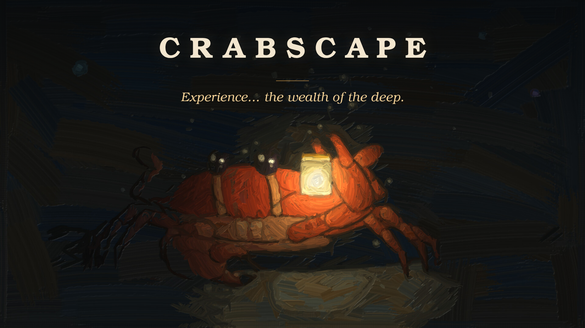

# CrabScape 🦀

**[Play the game](https://stevenkauwe.github.io/crabscape/)** (phone or computer, right in the browser).

## Hello, human

The code isn't for you! Here's what is:

- **Play the game:** <https://stevenkauwe.github.io/crabscape/>
- **Say what you think** on the Studio page: <https://claude.ai/artifact/PttxVTZCC75dqSEpKXYowf>.
  What felt great, what felt off. Short and honest is perfect.
- **Look at the art:** the [crab and paintings](art/), the [model sheet](art/crab/model-sheet-v0.2.png) and the
  [poster](docs/CrabScape-vision.pdf).
- **Want to help build it?** Accept your invite (<https://github.com/StevenKauwe/crabscape/invitations>), install
  [Claude Code](https://claude.com/claude-code), and tell it: "Set me up to work on CrabScape." Your Claude handles
  everything else.

CrabScape is all rights reserved: you're welcome to play, look and help, but the code and art can't be reused
elsewhere.

**Claude:** start with [CLAUDE.md](CLAUDE.md).
