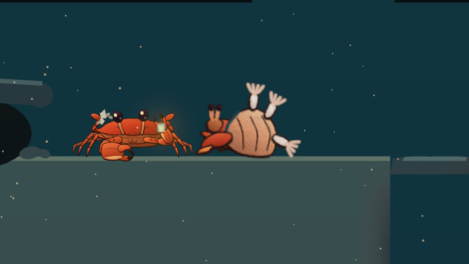
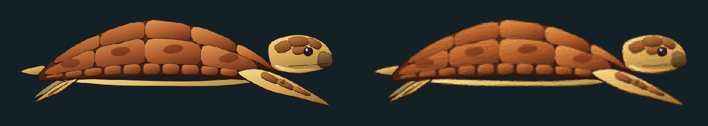
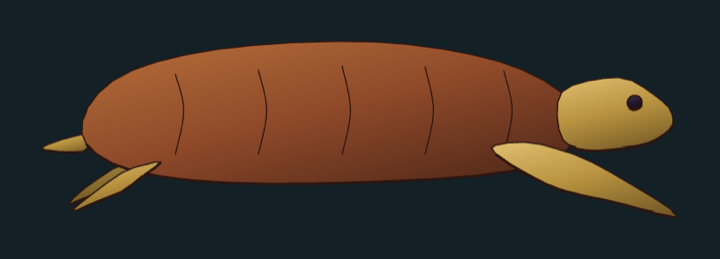
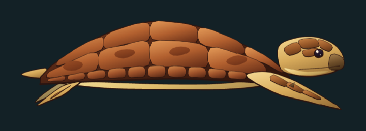
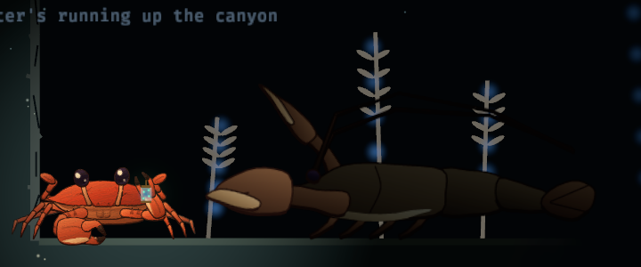
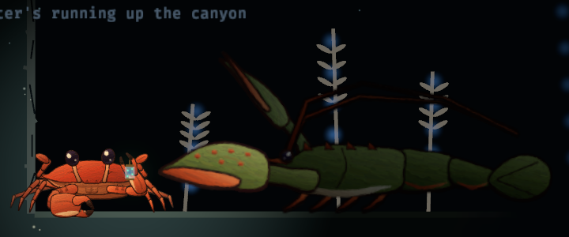
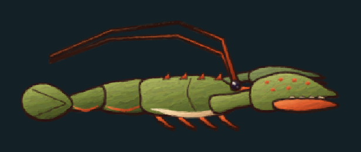
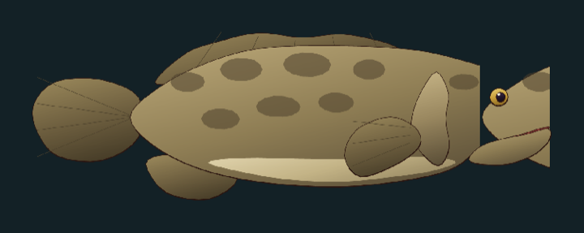
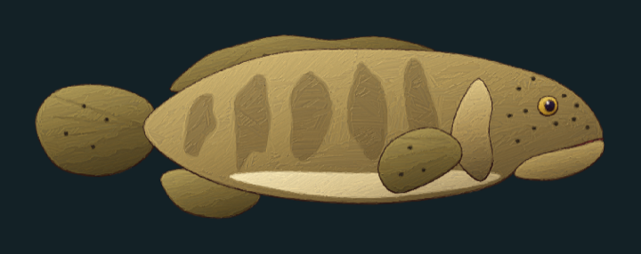

# Painted creatures: the look, and how to make it

Every animal in CrabScape is a cut-out puppet drawn in Rust (`crates/crabrig`) and then oil-painted by our own
painter (`crates/painter`, via `tools/paint-oil.sh`). This page is the recipe: what the look is, the exact steps and
commands, and what to do and avoid. Follow it for every new animal and every redraw, so they all belong together.
The wider art rules are in `art-direction.md`; this page is the creature-specific part of them.

## The look

The player crab is the reference (its parts: `assets/crab/crab-atlas-oil.png`). What makes it read:

- **A dark warm ink outline on every shape**, heavier on the side away from the light (the rig's SVG writer does
  this by itself: `crates/crabrig/src/svg.rs`).
- **Each shape lit on its own**: a light colour top-left, the base colour, a deep shade bottom-right. Every material
  is three colours (`Mat::Tri([lit, base, shade])`), and they span a big range of values: the lit colour clearly
  pale, the shade nearly dark. That range is what survives the dark sea and the paint.
- **Saturated, true colours**: each animal in its own real colours, pushed a little. Warm amber stays the crab's.
- **A pale underside** (countershading, which most sea animals have: a cream belly, a pale plastron, a silvery flank).
- **Detail as filled shapes, not thin lines**: plates, scales, spots and bands are small filled pieces with their
  own thin outline, so the painter paints each one. A line under about 2 rig units wide disappears in the paint.
- **Wet eyes**: a dark cornea with two white glints, top-left big and bottom-right small (`bestiary::glints`).
- **Painted**: visible brush strokes inside each shape, following it, never across the outline; nothing over the
  whole frame (no filters, no overlays).

Ink and oil, side by side (`oil-atlas preview`): the oil is the game's default style; ink stays as the other choice
in Settings and as the painter's input.

## Do and don't

| Don't | Do |
|---|---|
|  Detail as thin ink lines on a flat blob: the turtle's shell before. |  Filled plates with dark seams, a pale plastron, scaled head, beak, glinting eye. |
|  Dull brown on dark rock: the lobster before, at true scale in the game. Nothing reads but a smudge. |  Its own colours, pushed: olive shell, red-orange claws, joints and spines, a cream underside. |
|  Small, detailed parts painted at 1.8x: the strokes swallow spines, knobs and teeth. |  The same parts at 4x: the details survive and the paint still shows. |
|  A part wider than the atlas (the grouper before): cut off at the edge. The export now widens the atlas, but check the preview. |  The whole animal in one piece, with ragged mottling, not neat polka dots. |

Also:
- **Do** keep every part name and pivot the game uses (`src/creatures/<name>.rs` poses parts by name; the sim may
  name joints too, like the turtle's `MOUTH`). Redraw inside the same envelope.
- **Do** keep painted-in details inside their part's outline: anything outside shows as a stray blob.
- **Don't** add a separate moving part just for detail: details are `<part>--<detail>` pieces drawn into the part.
- **Don't** fix a look with a filter, tint or overlay in the game: change the drawing.
- **Don't** claim a real animal's colours without a source; write "not verified" if you have none.

## The steps

All commands run from the repository root. Each is deterministic.

1. **Draw the rig** in Rust: `crates/crabrig/src/bestiary/<module>.rs` for a bestiary animal (or its own module in
   `crates/crabrig/src`), registered in `crates/crabrig/src/bestiary.rs` (`NAMES`, `parts_svg`). Conventions:
   - shapes: `Item::new(Kind::Shape, id, Some(id), through(&points, 4, true), "material").sw(0.8)`, facing right,
     y down, 1 rig unit = 1 world unit; give moving parts a pivot with `.pv([x, y])`;
   - details: `bestiary::detail(part, name, points, material, ink)` (ink 0.4 to 0.7, or 0 for none),
     `bestiary::detail_line(...)`, `bestiary::glints(part, centre, radius)`; in `parent_of`, return
     `bestiary::owner(id)` first, so each detail is drawn into its part;
   - materials: `pal.insert("name", Mat::Tri([lit, base, shade]))`, with the lit colour well above the base and the
     shade well below. Draw back to front: far limbs, body, details, near limbs.
2. **Export the ink**:
   `cargo run -p crabrig --profile art -- parts --creature <name>` (writes `art/creatures/<name>/<name>-parts.svg`), then
   `cargo run -p crabrig --profile art -- export --creature <name>` (writes `assets/creatures/<name>-atlas.png` and
   `<name>-parts.json`).
3. **Look at the whole animal**:
   `cargo run -p oil-atlas --profile art -- preview /tmp/<name>.png 400 assets/creatures/<name>-parts.json assets/creatures/<name>-atlas.png`
   (assembles the puppet at rest; add `--hide <part>,<part>` to leave out overlays the game shows only sometimes,
   like the squid's `body-flash,head-flash`). Fix and repeat steps 1 to 3 until it reads.
4. **Choose the painting zoom** in `tools/paint-oil.sh` (and add the name to its default list): **1.8** for most;
   **4** when the widest part is under about 250 atlas pixels and has fine detail (legs, feelers, spines, teeth,
   spots: the shrimps, lobster, isopod, hagfish, viperfish, hermit crab, bobbit worm, amphipods); **lower** (1.5 for
   the grouper) when a part at 1.8 would be wider than about 1,850 pixels, the painter's sheet. A part's width at
   zoom 1 is its `rect` width in `<name>-parts.json`.
5. **Paint**: `tools/paint-oil.sh <name>` (writes `assets/creatures/<name>-atlas-oil.png`, same rectangles as the ink).
6. **Compare ink and oil**: the preview of step 3 with both atlases,
   `... preview /tmp/<name>.png 400 assets/creatures/<name>-parts.json assets/creatures/<name>-atlas.png assets/creatures/<name>-atlas-oil.png`.
   Details lost in the oil? Make them bigger or filled (step 1), or raise the zoom (step 4).
7. **Load it in the game**: `CreatureArt::load_scaled(parts_json, "creatures/<name>-atlas.png", scale, &assets)`
   loads the oil atlas next to it by itself. Add the name to `every_creature_has_an_oil_atlas_the_size_of_its_ink_one`
   in `src/creature_art.rs`, and its `parts` and `export` to the art job in `.github/workflows/ci.yml`.
8. **Look at it in the game, at true scale** (desktop):
   `cargo run -- --visit <kind> --photo /tmp/<name>` writes `/tmp/<name>-1.png`, `-2.png` and `-3.png` (1600 x 900,
   about a phone's pixels per world unit): a fresh crab beside the first animal of that kind, lantern at full glow,
   the camera on the animal, no save touched. `<kind>` is the sim's name (`crabsim::Kind::name`: `mantis`, `snapper`,
   `moray`, `octopus`, `triggerfish`, `alarm-jelly`, `loggerhead-turtle`, ...). `--style ink` for the ink look,
   `--beside 90` to start nearer (wakes an ambusher). Check: does it read as a silhouette? Can you see the tell? Does
   it sit with the crab? Fix and repeat.
9. **Check and ship**: `cargo fmt`, `cargo test -p crabrig` (rig drift), `cargo test --bin crabscape creature_art`,
   clippy native and wasm32. Push: the CI art job re-exports and repaints everything on Linux, and a Mac paints a few
   bits differently, so if it fails take its files:
   `gh run download <run-id> -n art-as-ci-made-it -D /tmp/art`, copy `/tmp/art/assets/creatures/*-oil.png` (and
   anything else it lists) over yours, commit, push. The PR shows the step 8 photos (CLAUDE.md: assets need in-game
   screenshots).

## Checklist
- [ ] Every part reads as a silhouette at its true size in the game (step 8 photo).
- [ ] Three-colour materials with a big value range; a pale underside; true colours (or "not verified").
- [ ] Details are filled pieces inside their parts; eyes have glints.
- [ ] Ink and oil previews compared; nothing important lost in the paint.
- [ ] Zoom chosen and recorded in `tools/paint-oil.sh`; the name in its default list and in the CI art job.
- [ ] Oil atlas loaded (`load_scaled`), tested (`creature_art` test), and the committed oil atlas is CI's.
